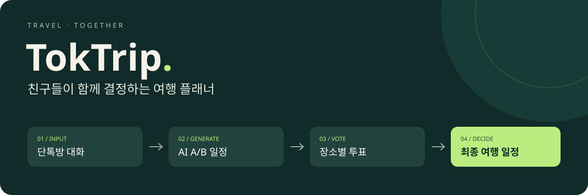
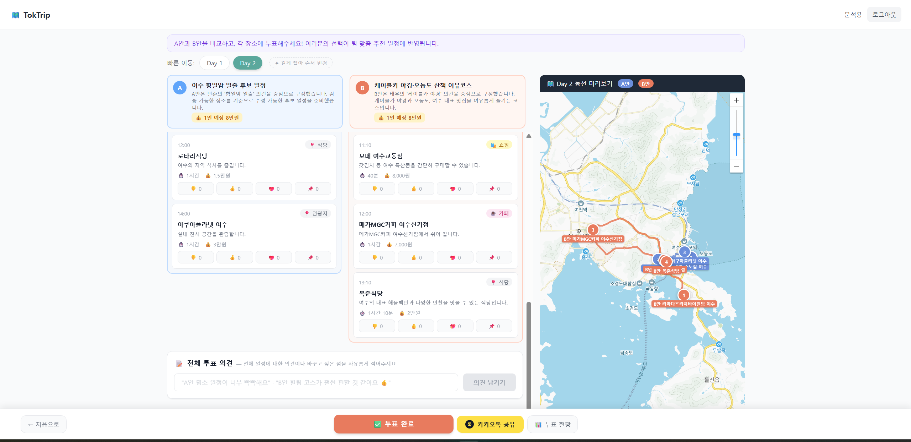
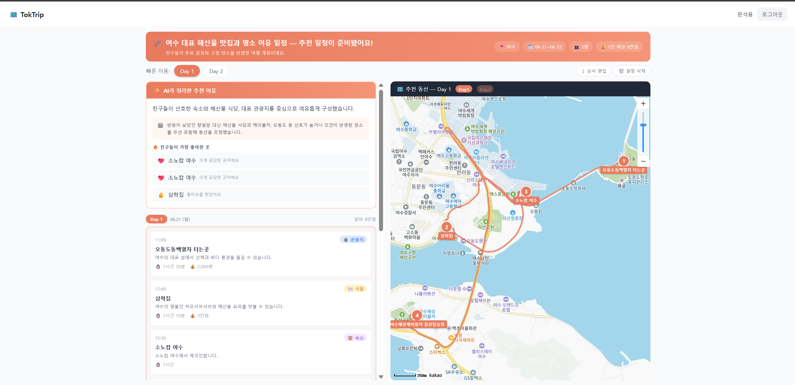

# TokTrip

**단톡방 대화를 바탕으로 AI가 여행 일정 후보 두 개를 만들고, 친구들의 장소별 선호와 전체 일정에 대한 의견을 모아 최종 일정을 추천하는 서비스입니다.**

**대학기업협력형 SW아카데미 6기 · 2026.02.02~06.18**

오브젠(주)이 제안한 「AI와 함께하는 통합 여행 플래너」를 선택해 2인 팀에서 TokTrip으로 구체화했습니다. [서경 SW아카데미 소개](https://swacademy.skuniv.ac.kr/about/#!/greeting)

[개인 기여와 의사결정](docs/contribution.md) · [공개 코드 근거](docs/code-evidence.md) · [시스템 구조와 구현 범위](docs/architecture.md)

> 최종 서비스명은 **TokTrip**입니다. 개발 당시 이름인 `triplan`은 패키지·클래스 경로에 남아 있습니다. 이 저장소는 비밀 설정을 제거한 공개용 소스 사본과 서비스 문서를 담고 있습니다. 개인 기여는 비공개 원본 팀 저장소의 변경 이력과 코드를 기준으로 정리했습니다.

## 어떤 문제를 풀었나요?

친구들과 여행을 준비하면 가고 싶은 곳, 예산, 식단 제약이 단톡방의 여러 메시지에 흩어집니다. 일정을 맡은 사람이 조건을 다시 정리하는 부담을 줄이기 위해 이미 나눈 대화에서 여행 조건을 추출하도록 했습니다. 후보 일정이 나오면 친구들이 장소별로 선호를 표시해 최종 일정에도 의견을 낼 수 있습니다.

오브젠 제안의 카카오 연동과 AI 여행 추천을 출발점으로 삼아, 단톡방 대화 입력과 장소별 투표 흐름은 팀에서 함께 기획했습니다.

| ① 대화 입력 | ② 후보 비교 | ③ 함께 선택 | ④ 최종 일정 |
| :--- | :--- | :--- | :--- |
| 대화 파일이나 텍스트와 추가 요청 입력 | 지도에서 일정 후보 두 개 비교 | 장소별 투표와 전체 일정에 대한 의견 남기기 | 여행을 만든 사람이 생성을 요청하면 투표와 전체 의견을 바탕으로 최종 일정 추천 |

호스트는 생성 결과를 확인한 뒤 공유할 때, 참여자는 일정을 보고 선택한 뒤 제출할 때 로그인하도록 흐름을 구성했습니다.

## 개인 기여

Spring Boot로 플랜 생성·후보 조회·투표 저장과 집계 API를 구현하고, 요청과 응답 형식에 맞춰 React 화면을 연결했습니다. AI 후보 생성과 장소 검증, 투표 기반 최종 일정 생성도 맡았습니다. 팀원이 만든 카카오 로그인에는 투표 화면으로 돌아와 선택을 이어가는 흐름을 추가했습니다. 팀원은 초기 인증과 길찾기 연동, 저장된 최종 일정의 조회 API 분리, Web Push와 배포 기반을 맡았습니다.

멘토 조언에 따라 화면이 필요로 하는 일정 JSON 형식을 먼저 정했습니다. 샘플 데이터로 후보 조회 API와 React 화면을 연결해 일정이 표시되는 상태를 만든 뒤 OpenAI를 연동했습니다. 이 순서 덕분에 화면 연동 문제와 AI 응답 문제를 구분해 살펴볼 수 있었습니다.

| 겪은 문제 | 구현과 선택 | 자세히 보기 |
| :--- | :--- | :--- |
| 추천 장소가 지도에서 검색되지 않거나 목적지 밖에 있음 | 카카오 장소 검색 결과와 목적지 범위를 확인해 좌표를 반영하고, 조건에 맞지 않는 장소는 대체하거나 제외 | [경험](docs/contribution.md#case-ai) · [코드](docs/code-evidence.md#ai) |
| 같은 카페에 낸 따봉을 왕따봉으로 바꿔도 표는 한 건이어야 함 | 투표 가능 상태와 후보·장소 소속을 검사한 뒤 동일 사용자·장소의 기존 표를 갱신. 여러 장소의 선택은 한 트랜잭션으로 저장 | [경험](docs/contribution.md#case-vote) · [코드](docs/code-evidence.md#vote) |
| 장소별 투표를 받아도 A/B 중 한 안을 통째로 선택 | 장소별 투표와 전체 일정 의견을 사용해 기존 장소 ID로 최종 일정을 재구성하고, AI 실패 시 규칙 기반 결과로 대체 | [경험](docs/contribution.md#case-final) · [코드](docs/code-evidence.md#final) |

## 기술 구성

| Backend | Frontend | 외부 연동·배포 |
| :--- | :--- | :--- |
| Java 17 · Spring Boot 3.5 · JPA · Security · MySQL | React 19 · Tailwind CSS · Axios · dnd-kit | OpenAI · 카카오 로그인·장소 검색·지도 SDK · Tmap 보행자 경로 · 카카오모빌리티 자동차 경로 · Web Push · Docker Compose · Nginx · KT Cloud |

[화면 → API → 서비스 → 저장소 연결과 상세 구조 보기](docs/architecture.md)

## 팀 조직과 공개 소스

[sku2026-triplan-dev](https://github.com/sku2026-triplan-dev)는 원본 개발 조직입니다. 원본 백엔드·프론트엔드 저장소는 비공개입니다. 이 공개 사본에서는 구현을 읽을 수 있으며, [개인 기여 문서](docs/contribution.md)는 비공개 원본 코드와 변경 이력을 기준으로 작성했습니다.

## 소스 코드

| 경로 | 내용 |
| :--- | :--- |
| [`backend/`](backend/) | Spring Boot API, AI 생성·검증, 투표, 최종 일정, 알림 구현과 테스트 |
| [`frontend/`](frontend/) | React S1~S5 화면, 인증 복귀, 투표·대시보드·확정 일정 흐름 |
| [`docs/code-evidence.md`](docs/code-evidence.md) | 핵심 코드의 역할과 설계 판단을 함께 읽는 안내서 |

실제 비밀번호와 외부 API 키, 빌드 결과물, IDE 설정, 로그와 기존 비공개 Git 이력은 포함하지 않습니다. 로컬 실행 시 [`backend/src/main/resources/application.properties.example`](backend/src/main/resources/application.properties.example)과 [`frontend/.env.example`](frontend/.env.example)을 참고해 환경 변수를 설정합니다.

## 배포와 회고

- **개발 당시:** KT Cloud에 배포해 대화 입력부터 후보 생성, 투표, 최종 일정 추천까지 시연했습니다. PC·Android·iOS에서 Web Push 수신도 확인했습니다.
- **현재:** 학교 클라우드 지원이 종료되어 상시 체험 서버는 제공하지 않습니다.
- **검증 기록:** 백엔드 테스트 116개 통과 기록과 2026-09-11 프론트엔드 빌드 성공 기록이 있습니다.
- **남은 과제:** 긴 실제 대화의 조건 보존, 동시 최종 생성 요청의 중복 AI 비용, 프론트 lint 오류.

시연으로 기능이 이어지는 것은 확인했습니다. 실제 여행을 준비하는 팀이 대화를 넣고 최종 일정을 고르는 과정은 별도로 검증하지 못했습니다. 다시 진행한다면 실제 여행 대화에서 중요한 조건이 빠지지 않는지, 참여자들이 투표를 마치는지, 최종 일정을 정하기 쉬웠는지 확인하고 싶습니다.

---

### 더 살펴보기

- [개인 기여](docs/contribution.md): 문제 → 선택 → 구현 → 한계
- [공개 코드 근거](docs/code-evidence.md): 비공개 원본 접근 없이 읽을 수 있는 실제 구현
- [구조·검증 범위](docs/architecture.md): 전체 흐름과 남은 개선점

**문석용 · [GitHub](https://github.com/Moonse01)**
